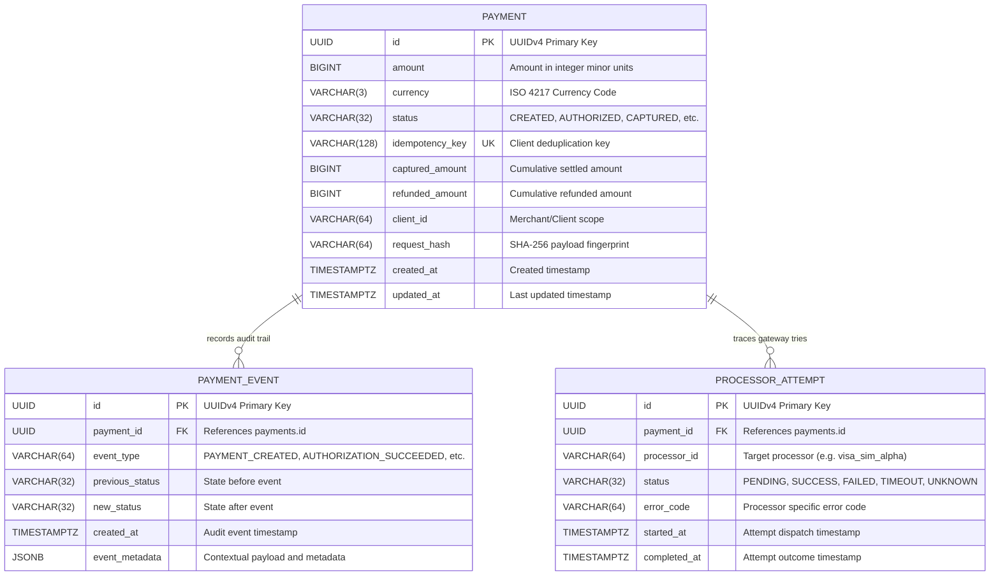

# PaySure Database Architecture & Design — Phase 1

## 1. Schema Overview

PaySure's relational schema is designed with financial-grade invariants:
- **Integer Minor Units**: Amounts are represented strictly as 64-bit integers (`BIGINT`) in minor currency units (e.g., USD cents, GBP pence, JPY whole units) to eliminate IEEE 754 floating-point rounding errors.
- **Timezone-Aware Timestamps**: All temporal columns use `TIMESTAMP WITH TIME ZONE` (`TIMESTAMPTZ`), normalized to UTC at the persistence boundary.
- **Immutable Audit Trail**: State transitions are logged to an append-only `payment_events` table for forensic reconstruction and audit compliance.
- **Processor Attempt Isolation**: Network-level interactions with external processors are stored separately in `processor_attempts`, isolating communication retries from the payment record's state.

---

## 2. Entity Relationship Diagram (ERD)

---

## 3. Table Specifications & Constraints

### 3.1 `payments`
Primary record representing an individual financial intention and lifecycle.

| Column | Type | Nullable | Default | Description |
|---|---|---|---|---|
| `id` | `UUID` | No | `uuid_generate_v4()` | Unique payment identifier |
| `amount` | `BIGINT` | No | - | Authorization amount in integer minor units |
| `currency` | `VARCHAR(3)` | No | - | ISO 4217 three-letter currency code |
| `status` | `VARCHAR(32)` | No | `'CREATED'` | Current lifecycle status |
| `idempotency_key` | `VARCHAR(128)` | No | - | Unique key submitted by the client |
| `captured_amount` | `BIGINT` | No | `0` | Cumulative amount settled/captured |
| `refunded_amount` | `BIGINT` | No | `0` | Cumulative amount refunded |
| `client_id` | `VARCHAR(64)` | Yes | `NULL` | Tenant/client identifier |
| `request_hash` | `VARCHAR(64)` | Yes | `NULL` | SHA-256 cryptographic digest of initial request |
| `created_at` | `TIMESTAMPTZ` | No | `NOW()` | Record creation timestamp |
| `updated_at` | `TIMESTAMPTZ` | No | `NOW()` | Last mutation timestamp |

#### Constraints & Indexes:
- `chk_payment_amount_positive`: `CHECK (amount > 0)`
- `chk_payment_captured_amount_non_negative`: `CHECK (captured_amount >= 0)`
- `chk_payment_refunded_amount_non_negative`: `CHECK (refunded_amount >= 0)`
- `chk_payment_refund_le_captured`: `CHECK (refunded_amount <= captured_amount)`
- `chk_payment_currency_length`: `CHECK (length(currency) = 3)`
- `ix_payments_idempotency_key`: `UNIQUE INDEX (idempotency_key)`
- `ix_payments_status_created`: `INDEX (status, created_at)`
- `ix_payments_client_created`: `INDEX (client_id, created_at)`

---

### 3.2 `payment_events`
Append-only transactional log capturing every transition and audit signal.

| Column | Type | Nullable | Default | Description |
|---|---|---|---|---|
| `id` | `UUID` | No | `uuid_generate_v4()` | Primary key |
| `payment_id` | `UUID` | No | - | Foreign key -> `payments(id)` ON DELETE CASCADE |
| `event_type` | `VARCHAR(64)` | No | - | Action name (e.g. `AUTHORIZATION_SUCCEEDED`) |
| `previous_status` | `VARCHAR(32)` | Yes | `NULL` | State before mutation |
| `new_status` | `VARCHAR(32)` | No | - | State resulting from mutation |
| `created_at` | `TIMESTAMPTZ` | No | `NOW()` | Event timestamp |
| `event_metadata` | `JSONB` | No | `'{}'` | Structured context (IP, gateway response, user agent) |

#### Indexes:
- `ix_payment_events_pid_created`: `INDEX (payment_id, created_at)`
- `ix_payment_events_event_type`: `INDEX (event_type)`

---

### 3.3 `processor_attempts`
Network and protocol attempt ledger for outbound gateway communications.

| Column | Type | Nullable | Default | Description |
|---|---|---|---|---|
| `id` | `UUID` | No | `uuid_generate_v4()` | Primary key |
| `payment_id` | `UUID` | No | - | Foreign key -> `payments(id)` ON DELETE CASCADE |
| `processor_id` | `VARCHAR(64)` | No | - | Processor identifier (e.g., `visa_sim_alpha`) |
| `status` | `VARCHAR(32)` | No | `'PENDING'` | `PENDING`, `SUCCESS`, `FAILED`, `TIMEOUT`, `UNKNOWN` |
| `error_code` | `VARCHAR(64)` | Yes | `NULL` | Standardized or processor-native error code |
| `started_at` | `TIMESTAMPTZ` | No | `NOW()` | Time of dispatch |
| `completed_at` | `TIMESTAMPTZ` | Yes | `NULL` | Time of acknowledgment or timeout |

#### Indexes:
- `ix_proc_attempts_pid_started`: `INDEX (payment_id, started_at)`
- `ix_proc_attempts_proc_status`: `INDEX (processor_id, status)`

---

## 4. Idempotency Key Scoping & Request Fingerprinting

### 4.1 Idempotency Key Scoping
In Phase 1, the `idempotency_key` column has a unique index across the table. In multi-tenant enterprise deployments (introduced in Phase 3), the uniqueness constraint will be scoped per client:
$$\text{UNIQUE INDEX} \ (client\_id, idempotency\_key)$$
This allows different merchant integrations to use their own internal order numbering schemes without cross-tenant key collision.

### 4.2 Request Fingerprinting (`request_hash`)
An idempotency key guarantees that a client retry does not initiate a second transaction. However, what if a buggy client sends two **different** requests with the **same** idempotency key (e.g., trying to charge $50.00 first, then attempting to charge $100.00 with the exact same key)?
- In Phase 3, PaySure will calculate `request_hash = SHA256(serialize(request_payload))`.
- When an idempotency key matches an existing record:
  - If `new_request_hash == existing_record.request_hash`: return the cached response (true idempotency).
  - If `new_request_hash != existing_record.request_hash`: reject with HTTP 422/409 `IDEMPOTENCY_KEY_PAYLOAD_MISMATCH` to prevent silent corruption.

---

## 5. Partitioning Strategy for Scaling (Roadmap Context)

As transaction volumes scale to millions of daily payments, the following partitioning approaches are planned for future phases:
- **Range Partitioning by `created_at`**: Monthly or weekly partition tables (`payments_2026_10`, `payment_events_2026_10`).
- **Cold Storage Archival**: Migrating events older than 180 days to compressed read-only object storage or analytical data warehouses while keeping active payments indexed.
