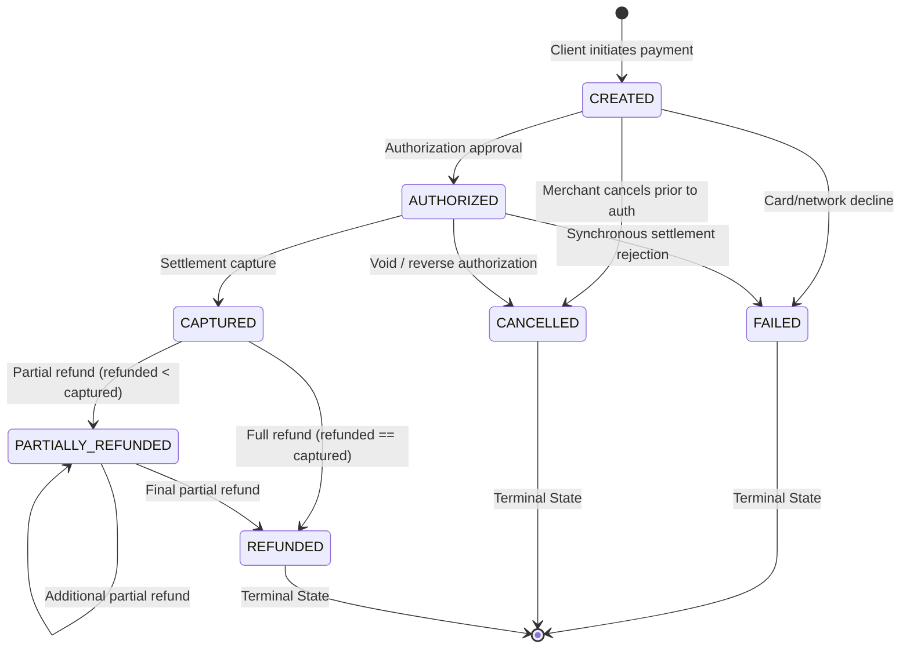

# PaySure Payment State Machine Specification — Phase 1

## 1. State Machine Definition

A payment transaction in PaySure transitions through an explicit, strictly enforced Finite State Machine (FSM). No arbitrary state mutations are permitted.

---

## 2. States & Descriptions

| State | Classification | Description |
|---|---|---|
| `CREATED` | Initial / Transient | Intent registered, idempotency key reserved, payload validated. Awaiting authorization attempt. |
| `AUTHORIZED` | Intermediate | Funds held on the issuer account; cardholder line of credit decreased, but funds have not yet settled. |
| `CAPTURED` | Intermediate / Settled | Funds transferred/settled into merchant ledger. Eligible for refunds. |
| `PARTIALLY_REFUNDED` | Intermediate | A portion of the captured amount ($0 < \text{refunded} < \text{captured}$) has been returned to the customer. |
| `REFUNDED` | Terminal | Total cumulative refunded amount matches total captured amount ($ \text{refunded} == \text{captured} $). |
| `CANCELLED` | Terminal | Authorization voided or payment cancelled before capture occurred. |
| `FAILED` | Terminal | Terminal decline or rejection (e.g. invalid credentials, card expired, hard fraud decline). |

---

## 3. Transition Matrix

| Current State | Target State | Legal? | Trigger / Condition |
|---|---|---|---|
| `CREATED` | `AUTHORIZED` | **YES** | Processor returns successful authorization code. |
| `CREATED` | `FAILED` | **YES** | Processor returns hard decline (e.g. `INSUFFICIENT_FUNDS`, `STOLEN_CARD`). |
| `CREATED` | `CANCELLED` | **YES** | Caller explicitly cancels transaction before processor dispatch. |
| `CREATED` | `CAPTURED` | **NO** | Direct capture without prior authorization violates card scheme rules. |
| `CREATED` | `REFUNDED` | **NO** | Unsettled funds cannot be refunded. |
| `AUTHORIZED` | `CAPTURED` | **YES** | Merchant or auto-capture requests settlement within capture window. |
| `AUTHORIZED` | `CANCELLED` | **YES** | Authorization reversed/voided before batch settlement. |
| `AUTHORIZED` | `FAILED` | **YES** | Downstream settlement processor returns fatal settlement error. |
| `AUTHORIZED` | `REFUNDED` | **NO** | Must be captured before refunding. |
| `CAPTURED` | `PARTIALLY_REFUNDED`| **YES** | Additional refund amount $> 0$ and cumulative refund $< \text{captured\_amount}$. |
| `CAPTURED` | `REFUNDED` | **YES** | Cumulative refund $== \text{captured\_amount}$. |
| `CAPTURED` | `AUTHORIZED` | **NO** | Settled transaction cannot revert to authorization. |
| `PARTIALLY_REFUNDED` | `PARTIALLY_REFUNDED` | **YES** | Incremental partial refund where total cumulative $< \text{captured\_amount}$. |
| `PARTIALLY_REFUNDED` | `REFUNDED` | **YES** | Incremental partial refund where total cumulative $== \text{captured\_amount}$. |
| `FAILED` | *Any* | **NO** | Terminal state. |
| `CANCELLED` | *Any* | **NO** | Terminal state. |
| `REFUNDED` | *Any* | **NO** | Terminal state. |

---

## 4. Invariants & Refund Accounting Rules

1. **Amount Invariant**:
   $$\text{amount} > 0$$
2. **Cumulative Capture Invariant**:
   $$0 \le \text{captured\_amount} \le \text{amount}$$
3. **Cumulative Refund Invariant**:
   $$0 \le \text{refunded\_amount} \le \text{captured\_amount}$$
4. **Remaining Refundable Formula**:
   $$\text{remaining\_refundable} = \text{captured\_amount} - \text{refunded\_amount}$$
   Any refund request with $\text{requested\_refund} > \text{remaining\_refundable}$ is rejected with a validation error.
5. **Positive Incremental Refund**:
   $$\Delta \text{refund} > 0$$
   Zero or negative refund requests are strictly rejected.

---

## 5. Distributed Systems: Timeout & Uncertain Outcome Handling

In real-world payment networks (VisaNet, ISO 8583 rails, or payment gateway APIs), the two generals' problem frequently manifests:
- Client issues an authorization request.
- The downstream processor successfully debits the customer's card.
- A network partition, load balancer timeout, or packet drop occurs on the return path before the ACK reaches PaySure.

### The Double-Charge Danger
If PaySure were to catch the network timeout and immediately mark the payment as `FAILED`:
1. The merchant or user assumes the payment did not happen and submits a second payment attempt.
2. The customer is charged twice on their statement for a single purchase.

### PaySure Design Pattern for Uncertain Outcomes
1. **Never Mark Payment `FAILED` on Timeout**:
   When an HTTP client timeout or socket error occurs, the `Payment.status` **must remain `CREATED`** (or `AUTHORIZED` for capture timeouts).
2. **Isolate Outcome in `ProcessorAttempt`**:
   The failure is recorded strictly at the transport attempt level:
   $$\text{ProcessorAttempt.status} = \text{"TIMEOUT"} \quad \text{or} \quad \text{"UNKNOWN"}$$
   with `error_code = "GATEWAY_TIMEOUT"`.
3. **In-Flight Lock**:
   A transient concurrency lock or status marker prevents concurrent duplicate processor requests while an attempt outcome is ambiguous.
4. **Resolution via Inquiry (Phase 3 & 4)**:
   Before any subsequent retry or cancellation is permitted, the system must invoke the processor's **Transaction Status Inquiry API** (e.g. Visa Resolve / Reverse) to determine whether the transaction was actually authorized at the gateway. Only after remote state confirmation can the payment safely transition to `AUTHORIZED` or `FAILED`.
